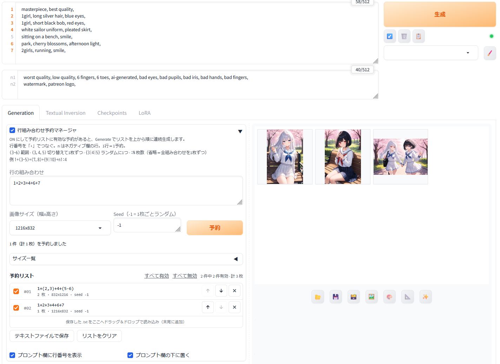

# Prompt Line Combo Queue

**English** | [日本語](README_ja.md)

A [Forge Neo](https://github.com/Haoming02/sd-webui-forge-classic/tree/neo) extension that builds prompts from **numbered lines** of the prompt field and **queues** many combinations, each with its own image size, seed and image count. One click on **Generate** runs the whole queue.

Write the prompt one idea per line:

```
1  masterpiece, best quality,
2  1girl, long silver hair, blue eyes,
3  1girl, short black bob, red eyes,
4  white sailor uniform, pleated skirt,
5  sitting on a bench, smile,
6  park, cherry blossoms, afternoon light,
```

…then queue combinations of line numbers:

```
1+2+4+5+6              -> one image
1+(2,3)+4+(5-6)        -> two images: one with line 2, one with line 3
1+{2|3}+4+5:8          -> eight images, line 2 or 3 picked at random each time
```



## Features

- **Line numbers in the prompt fields.** They work like a text editor's: wrapped lines get no number. Lines used by the combination you are typing are highlighted.
- **Combination syntax:** ranges, alternatives and random picks, all nestable (see [Syntax](#syntax)).
- **Queue with per-item settings.** Each item has its own image size, seed and count, and its own on/off checkbox. Items can be reordered or deleted, and the list can be saved to and loaded from a `.txt` file (drag and drop).
- **Random image size.** Pick a random size per image from your own size list, which you can edit in the panel.
- **The panel sits right under the prompt fields**, so you don't have to scroll down to the scripts area.
- **English and Japanese UI.**

## Requirements

- **Forge Neo** (Haoming02/sd-webui-forge-classic, `neo` branch). Other WebUI forks are not tested.
- **txt2img only.** img2img decides the latent size before the generation loop, so per-item sizes cannot work there.

## Installation

**From the WebUI:** Extensions → Install from URL → paste

```
https://github.com/aiaiai3d/sd-forge-prompt-line-combo-queue
```

→ Install → Apply and restart UI.

**Manually:** clone or download this repository into `extensions/`:

```
cd <Forge Neo>/extensions
git clone https://github.com/aiaiai3d/sd-forge-prompt-line-combo-queue
```

## Usage

1. Open **Prompt Line Combo Queue** in the txt2img Generation tab. The panel is on while it is open.
2. Write the prompt one part per line (subject, outfit, pose, place, style…).
3. In **Line combinations**, write one expression per line. Choose a size and seed, then press **Add to queue**.
4. Press **Generate**. The enabled items run from the top of the queue.

## Syntax

| Write | Means |
|---|---|
| `3` | line 3 of the Prompt field |
| `n2` | line 2 of the Negative prompt field |
| `1+2+5` | lines 1, 2 and 5, joined in the written order |
| `(3-6)` | range: same as `3+4+5+6` (`(n1-n3)` for negative lines) |
| `(3,4,5)` | alternatives: one image per alternative, in order |
| `{3\|4\|5}` | random: one of them for every image (Dynamic Prompts style) |
| `:N` at the end | number of images |

Groups can be nested, and an alternative can be a whole sequence:
`1+((3-5),7)+{n1|n2}` · `(2+3,4+(5,6))`

**How many images?**

- **No `:N`:** every combination once. `2+(3,4,5)+7` gives `2+3+7`, `2+4+7`, `2+5+7`.
- **`:N`:** N images, going through the combinations from the first one and wrapping around.
- **Several alternative groups multiply:** `(1,2)+(3,4)` gives `1+3`, `1+4`, `2+3`, `2+4`.
- **`{…}` adds no combinations.** It draws again for every image, and anything inside `{}` is random too.

**How the prompt is built**

- **Joining:** the chosen lines are joined with newlines, in the written order, and styles are applied afterwards. End each line with a comma if other extensions will read the prompt (see [Compatibility](#compatibility)).
- **Negative prompt:** an item without any `n` line gets an empty negative prompt.
- **Seed:** `-1` is random for every image. A fixed seed counts up within an item: seed, seed+1, seed+2…
- **When line numbers are read:** at **Generate**, from the prompt fields as they are then, not when the item was added.
- **Batches:** Batch count and Batch size are ignored while the queue is in use, so images are made one at a time. No grid is saved, because sizes can differ.
- **Infotext:** each image records `Line Combo: 2+4+7+n1` (the lines actually used) and `Line Combo Source: #1 2+(3,4,5)+7+n1`.
- **Hires. fix:** works, scaled from each item's size.

## Image sizes

- **Choosing a size:** pick one from the dropdown, type your own (`1024x1536`), or choose **Random (whole list)**. With Random, every image of that item gets a size picked from the list. The list is copied into the item when you add it, as `{832x1216|1216x832|…}`.
- **Size list editor:** type sizes one per line and press **Save list**, or add a size from width and height, or from an aspect ratio and megapixels (rounded to multiples of 8). **Replace with default list** loads the SDXL, SD 1.5 or Anima set, and **Sort by area** reorders the list.
- **Where it is saved:** `plcq_sizes.json` in the WebUI data folder, next to `config.json`, so updating the extension does not reset it. The `768,1280;512,512` format used by random-resolution extensions can be pasted in too.

## Queue file format

One item per line, separated by whitespace. Lines starting with `#` and blank lines are ignored.

```
<expression>[:N]  <size>  <seed>  [off]

2+(3,4,5)+7+n1      832x1216                        -1
1+{5|6}+n1:4        1216x832                        12345  off
(1,2)+3             {832x1216|1216x832|1024x1024}   -1
```

`<size>` is `WxH` for a fixed size, or `{WxH|WxH|…}` to pick at random for every image. `off` means the item is unchecked.

## Settings

- **Settings → Prompt Line Combo Queue → UI language:**
  - `Auto` uses Japanese when the WebUI Localization setting is a Japanese one, and English otherwise.
  - `English` and `日本語` force that language.
  - A change needs a UI reload.
- **Checkboxes at the bottom of the panel:** turn the line numbers on or off, and choose whether the panel sits under the prompt fields. Both are remembered by your browser.

## Compatibility

Script order matters here: Forge Neo runs extensions in folder-name order, unless you change it under Settings → Callbacks.

- **[TIPO (z-tipo-extension)](https://github.com/KohakuBlueleaf/z-tipo-extension):** works with the default timing, **"After applying other prompt processings"**. This extension builds each image's prompt first, and TIPO then expands each one. Things to know:
  - Set TIPO's timing to **"After"**. With "Before", TIPO rewrites the whole prompt field first, so the line numbers no longer match.
  - End each prompt line with a comma. TIPO splits tags only on commas, so two lines joined by a bare newline become one tag.
  - TIPO's aspect-ratio hint comes from the main Width and Height, not from each queue item's size.
  - Don't use TIPO's **Generate Prompt** button on a line-numbered prompt. It replaces the field's contents.
  - TIPO prepares the prompts for all queued images before the first one is generated. Long queues take a while to start.
- **Dynamic Prompts**, and other extensions that rewrite the per-image prompt list, may overwrite this extension's prompts or be overwritten by them. Use one or the other.

## Troubleshooting

- **Generate made normal images and ignored the queue.** Check that the panel is open (on) and that at least one item is checked.
- **Generation stopped immediately.**
  - An enabled item could not be used, for example because of a syntax error or a line number that does not exist.
  - The reason is printed to the console, and the item is marked in red in the queue. Fix the item or uncheck it.
- **Line numbers don't line up after resizing the window.** Click into the prompt field to redraw them.

## License

[MIT](LICENSE)
