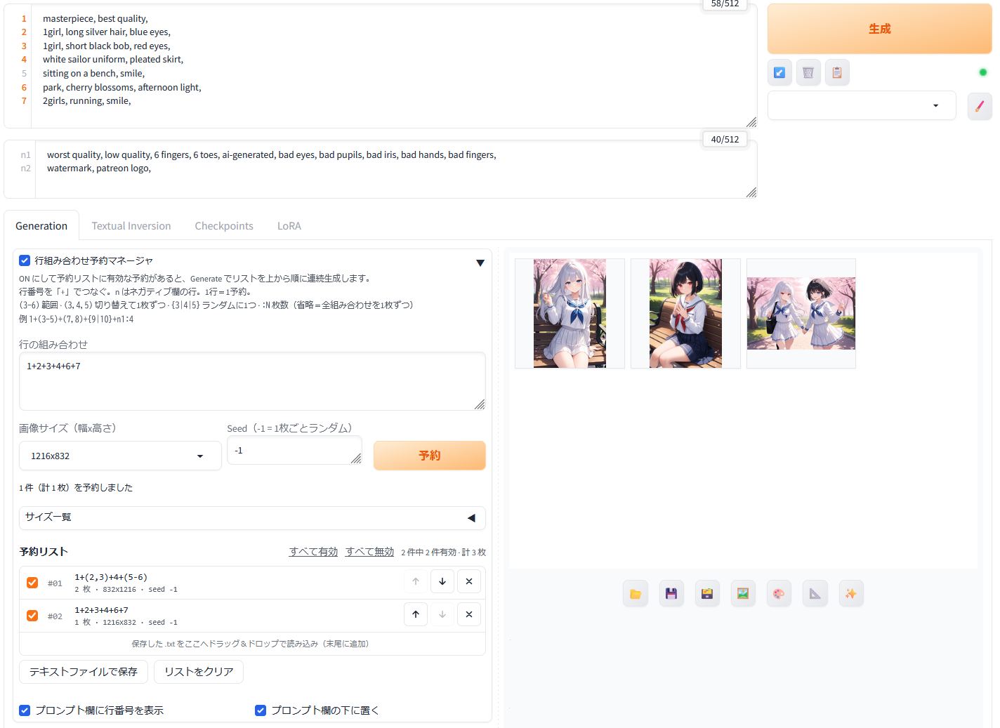

# 行組み合わせ予約マネージャ（Prompt Line Combo Queue）

[English](README.md) | **日本語**

[Forge Neo](https://github.com/Haoming02/sd-webui-forge-classic/tree/neo) 向けの拡張機能です。プロンプト欄の **行番号** を組み合わせてプロンプトを作り、画像サイズ・Seed・枚数つきで何件でも **予約** できます。Generate を1回押すだけで、予約リストをまとめて生成します。

プロンプト欄に要素を1行ずつ書いておき、

```
1  masterpiece, best quality,
2  1girl, long silver hair, blue eyes,
3  1girl, short black bob, red eyes,
4  white sailor uniform, pleated skirt,
5  sitting on a bench, smile,
6  park, cherry blossoms, afternoon light,
```

行番号の組み合わせを予約します。

```
1+2+4+5+6              -> 1枚
1+(2,3)+4+(5-6)        -> 2枚（2行目の版と3行目の版）
1+{2|3}+4+5:8          -> 8枚（毎回2行目か3行目をランダムに）
```



## 主な機能

- **プロンプト欄の行番号：** テキストエディタと同じ動きで、折り返した行には番号が付きません。入力中の組み合わせで使う行が光ります。
- **組み合わせの書式：** 範囲・切り替え・ランダム。どれも入れ子にできます（[書き方](#書き方)）。
- **予約ごとの設定：** 予約ごとに画像サイズ・Seed・枚数を指定でき、チェックでオン／オフを切り替えられます。並べ替えと削除ができ、予約リストは `.txt` に保存して、ドラッグ＆ドロップで読み込めます。
- **画像サイズのランダム：** 自分で編集できるサイズ一覧から、1枚ごとにランダムに選びます。
- **欄の位置：** 欄がプロンプト欄のすぐ下に来るので、スクリプト欄までスクロールせずに済みます。
- **表示言語：** 英語と日本語に対応しています。

## 動作環境

- **Forge Neo**（Haoming02/sd-webui-forge-classic の `neo` ブランチ）。他の WebUI では試していません。
- **txt2img のみ対応。** img2img は生成ループの前に潜在サイズが決まるため、予約ごとのサイズ切り替えができません。

## インストール

**WebUI から：** Extensions → Install from URL に次の URL を貼り付けます。

```
https://github.com/aiaiai3d/sd-forge-prompt-line-combo-queue
```

Install を押し、Apply and restart UI で再起動します。

**手動で：** `extensions/` にこのリポジトリを clone するか、ダウンロードして置きます。

```
cd <Forge Neo>/extensions
git clone https://github.com/aiaiai3d/sd-forge-prompt-line-combo-queue
```

## 使い方

1. txt2img の Generation タブで **行組み合わせ予約マネージャ** を開きます（開いている間が ON）。
2. プロンプト欄に、要素ごとに1行ずつ書きます（人物／服装／ポーズ／場所／画風 …）。
3. 「行の組み合わせ」に1行1件で式を書き、サイズと Seed を選んで **予約** を押します。
4. **Generate** を押すと、チェックの付いた予約をリストの上から順に生成します。

## 書き方

| 書き方 | 意味 |
|---|---|
| `3` | プロンプト欄の3行目 |
| `n2` | ネガティブ欄の2行目 |
| `1+2+5` | 1・2・5行目を、書いた順につなぐ |
| `(3-6)` | 範囲。`3+4+5+6` と同じ（ネガティブは `(n1-n3)`） |
| `(3,4,5)` | 切り替え。1つずつ順に、それぞれ1枚 |
| `{3\|4\|5}` | ランダム。1枚ごとにどれか1つ（Dynamic Prompts と同じ書き方） |
| 最後の `:N` | 枚数 |

括弧は入れ子にできます。切り替えの1つ1つを式にすることもできます。
`1+((3-5),7)+{n1|n2}` ・ `(2+3,4+(5,6))`

**枚数**

- **`:N` なし：** 組み合わせを全部1枚ずつ。`2+(3,4,5)+7` は `2+3+7`、`2+4+7`、`2+5+7` の3枚。
- **`:N` あり：** 組み合わせの最初から順に N 枚。N が組み合わせより多いときは、最初に戻って続けます。
- **切り替えが複数あると掛け算：** `(1,2)+(3,4)` は `1+3`、`1+4`、`2+3`、`2+4`。
- **`{…}` は組み合わせを増やしません。** 1枚ごとに引き直し、`{}` の中に書いたものは全部ランダム扱いです。

**プロンプトの作られ方**

- **つなぎ方：** 選んだ行を、書いた順に改行でつなぎます。スタイルはそのあとに適用されます。他の拡張がプロンプトを読む場合は、各行の最後にカンマを付けてください（[他の拡張との併用](#他の拡張との併用)）。
- **ネガティブ：** `n` の行が1つもない予約は、ネガティブプロンプトが空になります。
- **Seed：** `-1` は1枚ごとにランダム。固定値なら、その予約の中で seed, seed+1, seed+2 … と進みます。
- **行番号を読むタイミング：** 予約した時ではなく、**Generate を押した時点** のプロンプト欄から読みます。
- **バッチ：** 予約リストを使う間は Batch count / Batch size を無視し、1枚ずつ生成します。サイズが混ざるので、グリッド画像は保存しません。
- **infotext：** 各画像に `Line Combo: 2+4+7+n1`（実際に使った行）と `Line Combo Source: #1 2+(3,4,5)+7+n1` が残ります。
- **Hires. fix：** そのまま効きます。倍率は予約ごとのサイズが基準です。

## 画像サイズ

- **サイズの選び方：** ドロップダウンから選ぶか、直接入力します（`1024x1536`）。**ランダム（リスト全体から）** にすると、その予約の画像は1枚ごとに一覧からランダムなサイズになります。予約した時点の一覧が `{832x1216|1216x832|…}` の形で予約に書き込まれます。
- **サイズ一覧の編集：** 1行に1つずつ書いて **一覧を保存** します。幅と高さを入れて追加、または縦横比とメガピクセルから追加（8の倍数に丸めます）もできます。**初期リストに置き換え** で SDXL / SD 1.5 / Anima の初期セットを読み込み、**面積順に並べ替え** で並べ替えます。
- **保存先：** WebUI のデータフォルダ（`config.json` と同じ場所）の `plcq_sizes.json` です。拡張を更新しても消えません。解像度ランダム系の拡張で使う `768,1280;512,512` 形式を貼り付けても読めます。

## 予約ファイルの形式

1行1件、空白区切りです。`#` で始まる行と空行は無視します。

```
<式>[:枚数]  <サイズ>  <Seed>  [off]

2+(3,4,5)+7+n1      832x1216                        -1
1+{5|6}+n1:4        1216x832                        12345  off
(1,2)+3             {832x1216|1216x832|1024x1024}   -1
```

`<サイズ>` は固定なら `幅x高さ`、1枚ごとにランダムなら `{幅x高さ|幅x高さ|…}` です。`off` はチェックを外した予約です。

## 設定

- **Settings → Prompt Line Combo Queue → UI language：**
  - `Auto` は、WebUI の Localization が日本語のものなら日本語、それ以外なら英語です。
  - `English` / `日本語` を選ぶと、その言語に固定します。
  - 変更後は UI の再読み込みが必要です。
- **欄の一番下のチェック：** 行番号の表示と、欄をプロンプト欄の下に置くかどうかを切り替えます。どちらもブラウザが覚えています。

## 他の拡張との併用

Forge Neo は拡張をフォルダ名の順に実行します（Settings → Callbacks で変更できます）。

- **[TIPO（z-tipo-extension）](https://github.com/KohakuBlueleaf/z-tipo-extension)：** 既定のタイミング **「After applying other prompt processings」** なら一緒に使えます。この拡張が1枚ごとのプロンプトを作ったあとで、TIPO がそれぞれを膨らませます。注意点：
  - TIPO のタイミングは **「After」** にしてください。「Before」だと TIPO が先にプロンプト欄全体を書き換えるので、行番号が合わなくなります。
  - 各行の最後にカンマを付けてください。TIPO はカンマだけでタグを区切るので、カンマなしで改行だけでつないだ2行は1つのタグになってしまいます。
  - TIPO の縦横比のヒントは、生成画面の Width / Height から取られます。予約ごとのサイズは反映されません。
  - 行番号を付けたプロンプトで TIPO の **Generate Prompt** ボタンを押さないでください。欄の中身が置き換わります。
  - TIPO は、1枚目を生成する前に全部の画像のプロンプトを作ります。予約が多いと、生成が始まるまで時間がかかります。
- **Dynamic Prompts など：** 1枚ごとのプロンプトの一覧を書き換える拡張とは、互いに上書きし合うことがあります。どちらか一方を使ってください。

## うまくいかないとき

- **予約リストが使われず、普通に生成された。** 欄が開いている（ON）か、チェックの付いた予約が1件以上あるかを確認してください。
- **生成がすぐ止まった。**
  - チェックの付いた予約の中に、使えないもの（書式エラー、存在しない行番号など）があります。
  - 理由はコンソールに出て、予約リストではその予約が赤字になります。直すか、チェックを外してください。
- **ウィンドウの大きさを変えたら行番号がずれた。** プロンプト欄を一度クリックすると描き直されます。

## ライセンス

[MIT](LICENSE)
